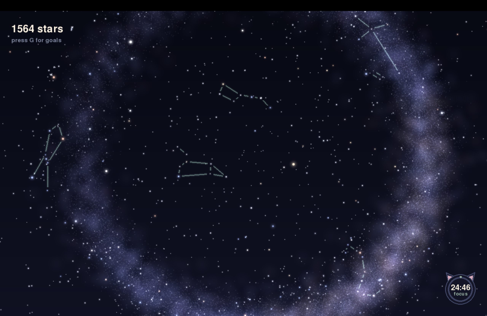

# star-goals

A real-time glowing night sky that grows as you finish your own goals.

The sky matches the real sky for your location and time. You start with an empty sky. Every goal you tick earns stars, and new stars appear on the map, brightest first. Earn enough and real constellations light up.

## Features

- Real stars from the HYG star catalog, placed for your time and location
- Soft glow and a slow twinkle on every star
- A Milky Way band that fades in as you earn stars
- Your own goals, daily or one-time, with the number of stars you choose
- Daily goals can be ticked as many times as you want in a day, with a counter
- Edit, delete and drag your goals to reorder them, new goals are added at the top, and long lists scroll
- 8 real constellations unlock as your star count grows
- New stars pulse with pink rings, and shooting stars start after 500 stars
- A small Pomodoro timer with a session log, which shrinks into a glowing moon
- Everything is saved in local files, no internet needed

## Setup

You need Python 3.

1. Install pygame-ce (use this, not plain pygame, so it works on new Python versions):

        python3 -m pip install pygame-ce

2. Copy the location file, then open `config.py` and put in your own latitude and longitude (east longitude is positive):

        cp config.example.py config.py

3. Run it:

        python3 sky.py

## Controls

- **G**: open or close the goals panel
- **Click a goal**: tick it and earn stars. A daily goal can be ticked many times a day, and a counter like x3 shows how many times
- **Right-click a goal**, or click the small minus: undo one tick
- **One-time goals**: click once to finish, click again to undo
- **Up and down arrows**: move a goal in the list
- **sort**: unfinished goals first, daily before one-time, finished goals last
- **edit**: change a goal's name, stars, or repeat setting
- **x on a goal**: click twice to delete it (you lose the stars it gave)
- **+ Add goal**: make your own goal (Tab moves between boxes, Enter saves, Esc cancels)
- **Mouse wheel or two-finger scroll**: scroll a long list
- **F**: switch between fullscreen and window
- **C**: show or hide constellation lines
- **Esc**: quit

## Pomodoro timer

A small timer card sits in the top right corner.

- Play or pause, skip to the next part, or reset
- **set**: change the focus, short break and long break lengths (shift+click changes by 5)
- **log**: see today's and this week's focus time, and every session you finished or stopped
- The small minimize button turns the card into a glowing moon in the bottom right corner. Click the moon to open the card again, or right-click it to start and pause

## Make it yours

- Constellation costs are in `COSTS` at the top of `sky.py`
- Shooting star settings are at the top of `shooting.py`
- Timer settings and the card position are at the top of `pomodoro.py`
- Your goals and star count are saved in `data.json`, and your timer log in `pomodoro_data.json`. Both are created on first run and are not uploaded to GitHub

## Credits

Star data comes from the HYG Database by David Nash (astronexus.com). Please check its page for its license terms.

Built by Jadebit.
EOF